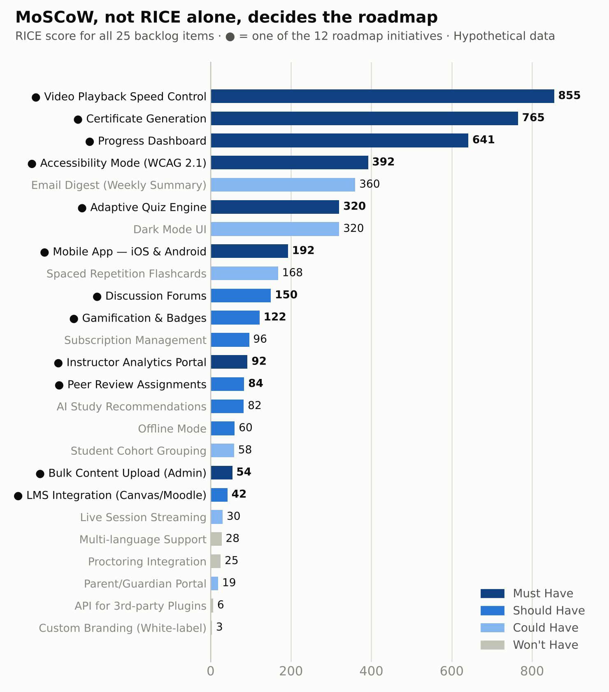
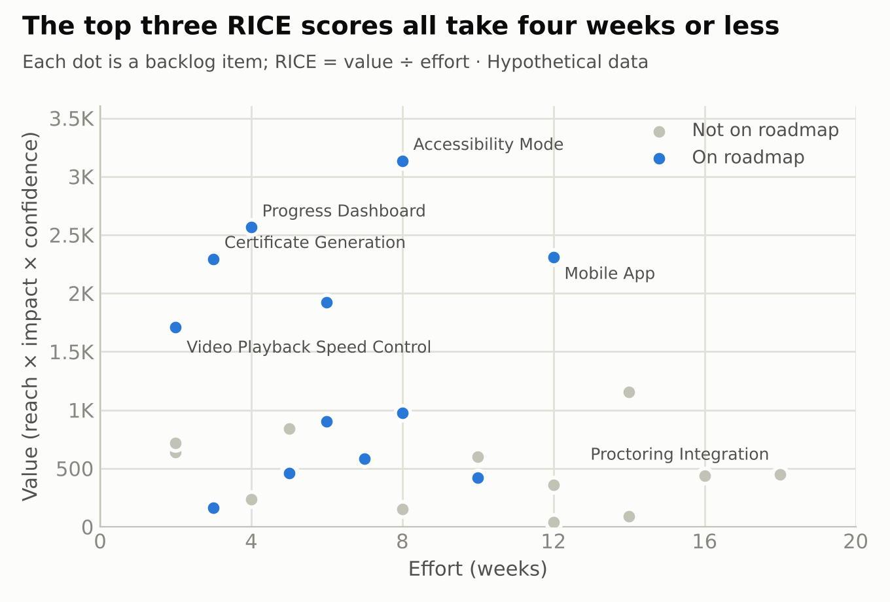
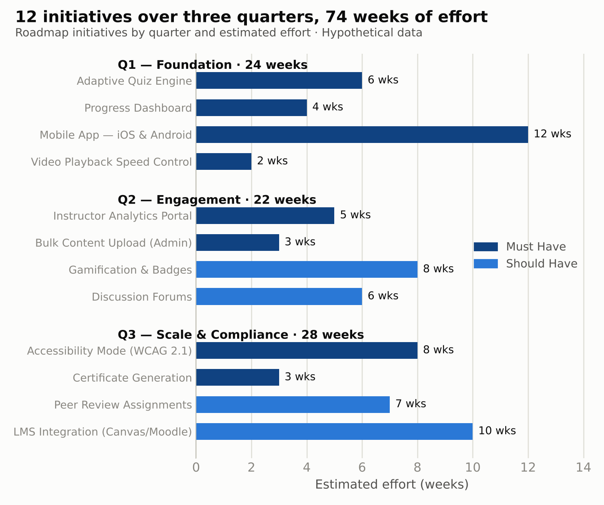
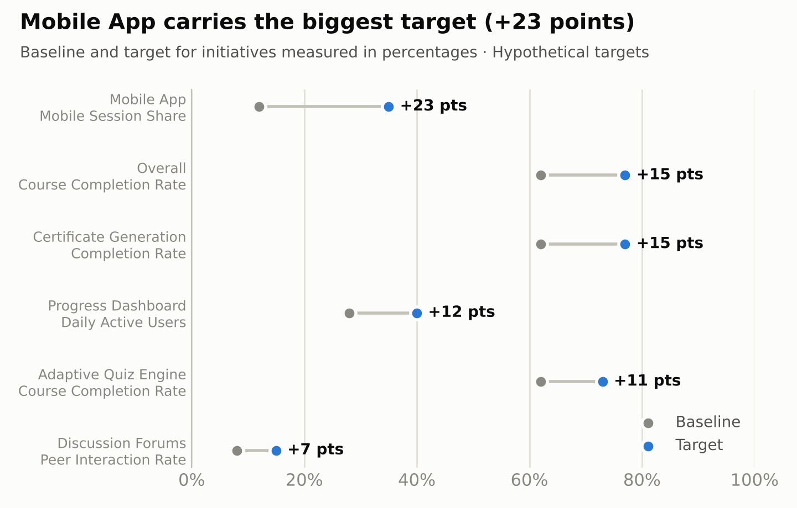

# Feature Prioritization and Product Roadmap for an EdTech Platform

A product roadmap for a **hypothetical** EdTech platform, built as an independent project. Requirements from three stakeholder groups (students, instructors and administrators) are combined into a 25-item backlog, scored with RICE, classified with MoSCoW, and turned into a 12-initiative plan across three quarters with success metrics for each initiative.

> **Data note:** the platform, stakeholder counts, scores, baselines and targets are all hypothetical planning figures. The project shows the prioritization workflow.

## Key points

| | Point |
|---|---|
| **Top RICE scores** | Video Playback Speed Control (855), Certificate Generation (765) and Progress Dashboard (641). All three take four weeks or less. |
| **How the roadmap was chosen** | The roadmap takes all 8 Must Haves plus 4 of the 7 Should Haves. Two Could Haves with high RICE scores (Email Digest, 360, and Dark Mode, 320) were left out because MoSCoW priority comes first. |
| **Effort** | 74 weeks of estimated effort: 24 in Q1, 22 in Q2 and 28 in Q3. |
| **Goal** | Raise course completion from 62% to 77% (+15 percentage points). The largest single target is mobile session share, from 12% to 35%. |









## Method

**RICE score** = (Reach × Impact × Confidence) ÷ Effort

- **Reach:** users affected per quarter
- **Impact:** 1 (low) to 3 (high)
- **Confidence:** how sure the estimate is, as a percentage
- **Effort:** estimated weeks of work

**MoSCoW** sorts each item into Must Have, Should Have, Could Have or Won't Have for this plan.

## What's in the workbook

`03_Feature_Prioritization_Roadmap.xlsx`

| Sheet | Contents |
|---|---|
| `Feature_Backlog` | All 25 items with stakeholder source, category, RICE inputs and score, MoSCoW class and quarter |
| `Product_Roadmap` | The 12 initiatives by quarter, with business impact, success metric and effort |
| `RICE_MoSCoW_Scoring` | The scoring method worked through for 12 features, with a rank for each |
| `Success_Metrics` | Primary KPI, baseline, target and acceptance criteria for each initiative |

## Reproduce the charts

```bash
pip install -r requirements.txt
python scripts/make_charts.py 03_Feature_Prioritization_Roadmap.xlsx charts
```

## Changes in this version

- Labelled the workbook as an independent project, and the stakeholder counts, baselines and targets as hypothetical
- Filled in the empty Rank column on `RICE_MoSCoW_Scoring`
- Stated the overall goal consistently as +15 percentage points (62% to 77%)
- Added four charts, the chart script and `requirements.txt`

---

Neha Verma · [Portfolio](https://nehaverma-portfolio.netlify.app) · [LinkedIn](https://www.linkedin.com/in/neha-verma-03197030b)
